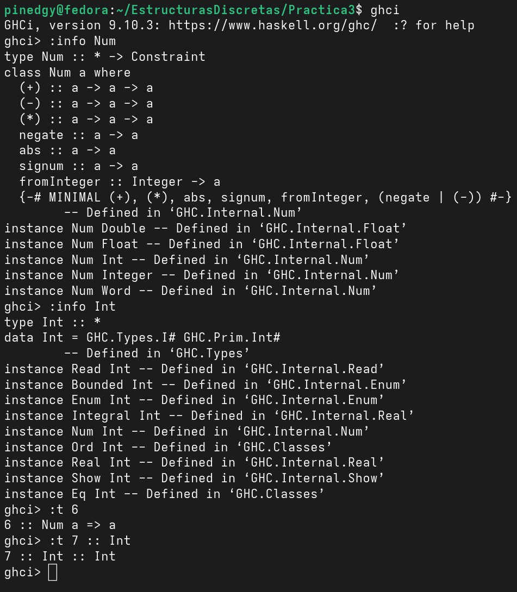

# Practica 4

## Objetivo de la Practica:
Entender como implementar las listas por comprensión para trabajar con
más datos de manera más simple y utilizar modulos para que el código principal no se sature y sea facíl de entender y trabajar.

## Tiempo requerido:
Tome aproximandamente 3 días en sesiones de 3 a 4 horas.

## Ejercicio favorito:
El ejercicio 6 fue el que más me gusto, ya que tuve que pensar en una
función auxiliar que detectara si un número es primo o no,implementarla en el modulo para al final implementarla en la función principal.

### Ejercicio 1: ¿Cuál es la diferencia entre Num e Int?
La diferencia entre Num e Int radica en que Num es una clase de tipos, donde sus miembros tienen la propiedad de comportarse como cualquier tipo de números,  incluso los enteros. Por su parte Int es un tipo de dato concreto por eso solo trabaja con números enteros. Como ejemplo al ingresar un número en Haskell no se le asigna un tipo directamente si no que lo trabaja dentro de Num que puede ser cualquier tipo de número como Float, Double, Integer o Int.

### La Chivita Recursiva:
La recursión en la canción _Sal de Ahí Chivita Chivita_ se hace presente en el momento en el que tenemos un problema, en este caso sacar a la Chiva de un lugar. Decidimos llamar a una función para resolverlo pero está se vuelve a llamar una y otra vez hasta llegar a un caso conocido (caso base), en la cación se llama al Burro para poder sacar a la Chiva, como el Burro no puede se llama al Ratón para que saque al Burro y el Burro ahora si saque a la Chiva. 

Durante la canción se hacen varios llamados a diferentes animales para sacar al último animal llamado, hasta llegar a la persona que es capza de sacar al último animal llamado (el Pato), que ya afuera saca al animal que fue llamado antes que el (el Perro), así hasta conseguir sacar a la Chiva. En la recursión ocurre igual, partiendo de un caso base se llega a un caso recursivo que nos permite llamar a la función tantas veces sea necesario hasta llegar al caso base para resolver un problema.

